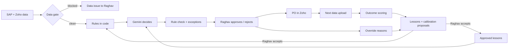

# Freshroots Demand Planner — engineering plan

The first build made decisions. This plan makes them **safe to trust** and **better every week**.

## 1. What was weak

| Area | Weakness | Failure it causes |
|---|---|---|
| Feedback | Open loop: nobody records what actually happened after a decision | Can't tell if the system beats the manual baseline; can't learn |
| Data | No quality gate before the AI step | SKU009 had no inventory row; Gemini guessed "stockout" |
| Runs | One Gemini call, no retry, no timeout budget, no lock | A transient error fails the run; two cron calls can run at once |
| Traceability | Prompt, rules and model not stored per run | A decision can't be reproduced or explained later |
| Quality | No eval set | A prompt or model change can silently make decisions worse |
| UX | 15 tall cards, one per SKU, category photos | Slow triage; photos don't match the product |

## 2. The closed loop

Every arrow is stored in Neon, so every step can be audited.

### 2.1 Outcome scoring (what happened)
When a newer sales week and inventory snapshot arrive, every decided line from an earlier run is scored:
- **Demand error:** actual average weekly sales in the weeks after the run vs the weekly demand the run used (bias and absolute % error).
- **Stock outcome at the next snapshot:** `stocked_out` (on hand 0 or a stockout report), `under_window`, `in_window`, `over_window`.
- **Verdict:** `right` (the action would have kept or moved stock toward the window), `missed_stockout`, `missed_overstock`, `unnecessary_order`, `unscored` (data missing).

### 2.2 Human feedback (what Raghav thinks)
- Reject reasons and quantity-change reasons are already required. They're now tagged by type (demand signal, distributor scheme, supply issue, data wrong, other).
- Every line can get a one-tap "useful / not useful" rating. This is the instrument from the pre-build check: *"Did this recommendation hold up?"*

### 2.3 Learning (what changes next run)
- **Lessons:** the system drafts a lesson from each repeated pattern (e.g. "Raghav keeps raising Bread qty in festival weeks"). Raghav approves or discards it. Approved lessons go into Gemini's context on every run. Nothing is learned without a human yes.
- **Calibration proposals:** if outcomes show a consistent bias (e.g. festival demand under-forecast by 18% across 3 runs), the system proposes a rubric change with the evidence. Accepting it writes a new rubric version; the old one is kept.
- **Kill switch** now also trips on outcome quality: missed stockouts on fresh SKUs in the scored window.

## 3. Reliability

| Guard | Rule |
|---|---|
| Data gate | Blocks the run when: inventory older than 10 days, latest sales week older than 3 weeks, or more than 20% of SKUs missing inventory. Warns (exception, no AI guess) for single missing rows. |
| Run lock | Postgres advisory lock: only one run at a time; a second cron call is skipped and logged. |
| Gemini | 2 retries with backoff on 429/5xx/timeout, 60 s budget per batch, schema-enforced JSON, every SKU must come back exactly once. |
| Traceability | Each run stores model, prompt version, rubric version, input hash, token usage and duration. |
| Same-data guard | A cron run on unchanged data is skipped (nothing new to decide). |
| Fail safe | Any failure leaves the previous queue in place and shows the error. No partial queues. |

## 4. Quality gates

- **Unit tests** (offline): rules engine, data gate, outcome scoring, decision merge, Zoho client.
- **Eval** (`npm run eval`, live Gemini): golden cases from the case data with expected flag and action. Pass bar: 100% on flags and actions for the sample set; any miss fails the eval.
- **CI** (GitHub Actions): typecheck, unit tests and build on every push.

## 5. UX

- Review is a **triage inbox**: compact queue on the left (exceptions → stockout → overstock → OK), full detail on the right.
- Keyboard: `J`/`K` move, `A` approve, `R` reject, `/` search.
- Each SKU has its own matching product photo; page headers match the page's job.
- A **Learning** page shows the loop: decision accuracy, forecast bias, Raghav's override reasons, pending lessons and calibration proposals.

## 6. What stays out of scope

- Automatic rubric changes without Raghav's approval.
- Forecasting beyond Raghav's rules (no ML model until outcome data exists to train and validate it).
- Write-off value: no data source yet.
